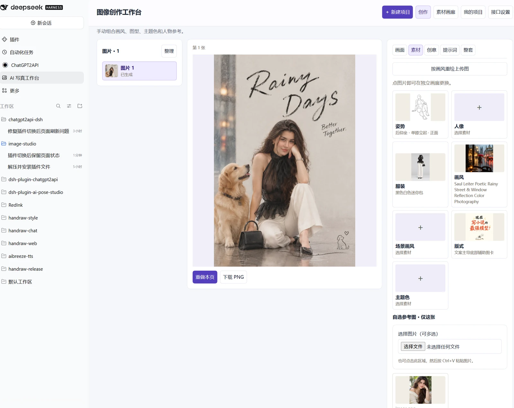

# 图像创作工作台

一句主题，出一整套图：方案、画风、版式、配图、成图，全都替你想好。

这是给 **DSH（DeepSeek Harness）** 用的图像创作插件。写一句「雨天街拍姿势指南，复古手绘，做 6 张」，它会先拆成封面、步骤、对比、总结，再逐张出图。

## 能做什么

- **一句话出方案**：自动拆页，每页配好画风、配色、版式和参考姿势，不满意点开素材画廊换掉
- **整套视觉统一**：角色、服装、画风、配色和一张参考图贯穿全篇，不用每页重新描述
- **素材随手换**：内置 368 组画风、36 组配色、170 种版式，点缩略图就能替换
- **平台尺寸**：小红书、抖音、公众号、B 站、Instagram、YouTube、方图、竖版
- **不丢进度**：切面板、刷新、关窗口都能接着来；成图生成中切走也不会中断

## 安装

对 DeepSeek 说这一句就行：

> 帮我安装插件：https://github.com/yang0/dsh-handraw-style

它会把插件装好并提醒你启用。启用后左栏点 **AI 写真工作台** 就能用。

想自己点也行：DSH 左栏 **插件** → **添加插件** → **安装第三方插件**，粘上面的仓库地址；或者命令行 `dsh plugin --profile web add "github:yang0/dsh-handraw-style"`。

## 开始出图

生图需要一个兼容 GPT Image 的接口（OpenAI 官方或任意中转站）。打开 **接口设置**，填 Base URL 和 API Key，默认模型 `gpt-image-2`。

点 **生成方案** 会用 DSH 当前的默认模型做规划，不需要另外配文本模型。确认方案后，单页生成或批量生成，最后 **导出整套 ZIP**。

## 素材说明

画风、配色、版式是内置的，装完就能用。姿势、服装、人像图库是可选素材包（约 1.1 GB），没有它也能规划、出图和上传自己的参考图。

素材来源与版权见 [NOTICE.md](NOTICE.md)。要改源码看 [DEV.md](DEV.md)。
